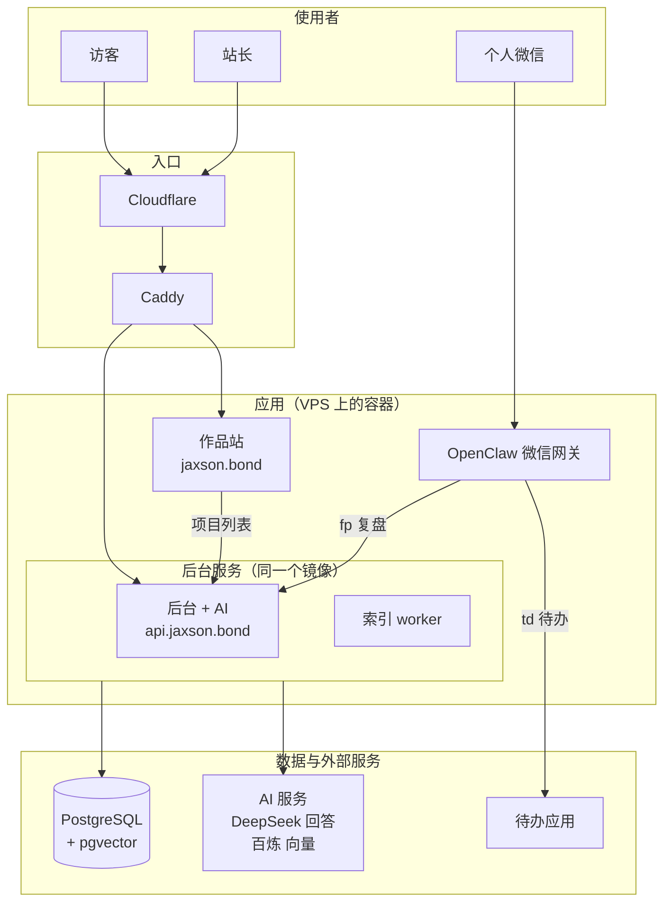
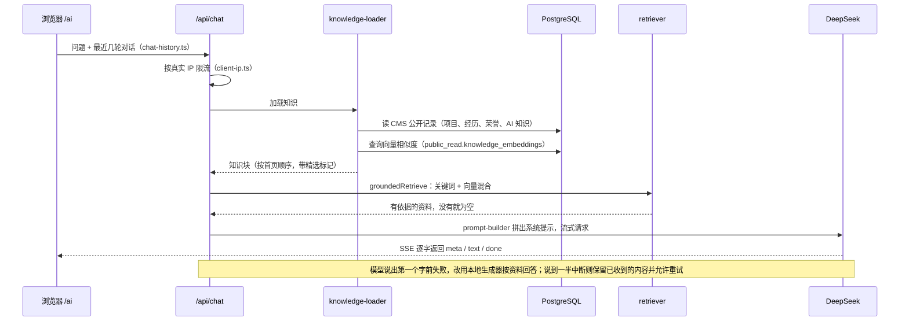
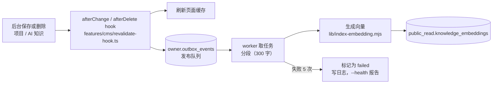
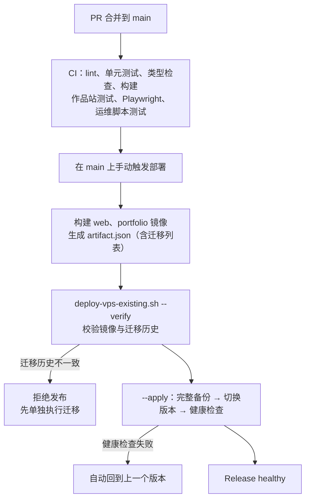

# 项目架构图与故障定位

先看图找到出问题的部分，再按第 5 节的表格直接打开对应文件或执行检查命令，不必通读整个仓库。每个文件夹的用途见 [目录索引](./目录索引.md)。

图用 Mermaid 编写，GitHub 和多数编辑器的 Markdown 预览会直接画出来。

## 1. 整体结构：谁连着谁

从上往下是一次请求经过的层次：谁在用 → 入口 → 应用 → 数据和外部服务。

图里省略了两条运维线路：GitHub Actions 通过 SSH 发布新版本（见第 4 节）；站长电脑用 `docker/windows-pull-backup.py` 拉取加密备份，用 `docker/windows-monitor.py` 做在线监测。

- **jaxson.bond**：`portfolio` 容器用 `apps/portfolio/scripts/serve.mjs` 提供静态首页，只把 `/api/showcase-projects` 代理到 web（`showcase.mjs`）。首页的对话框由访客浏览器直接请求 `api.jaxson.bond/api/chat`，这样限流拿到的是访客自己的 IP；CORS 只允许作品集的域名（`apps/web/src/features/portfolio/cors.ts`）。`/ai` 保留为全屏对话页。
- 本地待发布的会话接续：普通点击首页“全屏对话”后，新窗口通过 postMessage 握手取得会话和草稿；发送方与接收方都验证窗口、配置的 origin 和一次性标记，接收方再用 `conversation-handoff.ts` 校验长度、角色、状态及来源。URL 仅携带返回地址和短期握手标记，成功后删除标记；不存服务端，不自动发问，两页后续独立。生成或编辑中需先结束当前操作，接续失败保留原首页。
- **api.jaxson.bond**：`web` 容器包含 Payload 后台 `/admin`、AI 对话 `/ai` 与 `/api/chat`、简历 `/resume`、项目详情 `/projects/[slug]`、私人工作台 `/studio`。
- **私人页面**：`/studio`、`/api/studio/memory` 和后台由 `apps/web/src/middleware.ts` 加 Cloudflare Access 保护，路由内部也会再检查一次（`features/studio/private-access.ts`）。`/api/studio/inbox` 只接受 OpenClaw 的口令和白名单发送者。

## 2. 访客问 AI 一个问题

## 3. 后台改一条内容，到 AI 能检索到

- 回答内容永远取自 CMS 的实时公开记录。向量索引只负责“哪条更相关”，索引过期不会泄露已撤回的内容，但会让检索不准。
- 经历和荣誉不进向量索引，靠关键词和主题路由检索（`retriever.ts` 的 `TOPIC_CATEGORIES`）。
- 项目的角色和公开参与说明（CMS 的 editorialNote）同样属于回答依据：`data.ts` 保留为 role / note，知识加载器把它们与项目使用的技术一并交给 AI；首页弹窗和独立详情页也展示参与说明，避免只列技术栈而漏掉实际分工。

## 4. 发布到生产

Caddyfile 和 `production.env` 沿用服务器上当前版本的副本，不随仓库发布。具体步骤见 [部署交接](./部署交接-2026-10-22.md) 和 [生产运维与数据迁移](./生产运维与数据迁移.md)。

2026-10-28 本地修复版：CI 增加生产依赖 high 级安全门禁，使用独立 SQLite 和合成媒体运行公开页浏览器测试；发布健康检查验证 `/ai`、完整聊天 SSE 和 worker 队列。`check-public-health.mjs` 限制超时及响应大小，不记录问答正文。Compose 增加 worker healthcheck，但服务器保留的配置需要另行同步。

上线准备补充：CI 使用独立 PostgreSQL + pgvector 演练正式迁移，并构建、运行两份生产镜像，重跑公开页浏览器测试。`rehearse-database.mts` 不读取生产数据库配置，只接受空的 loopback 演练库。发布包附带受限运维 SQL 及独立校验和，迁移仍不自动执行；健康 checker 随工具包提供并通过 stdin 传给容器，确保旧镜像回退时无需新文件。复现与发布顺序见 [上线候选验收](./上线候选验收-2026-10-28.md)。

聊天在应用读取请求流时限制 64 KiB，Caddy 同时配置相同上限；同一 Web 进程最多 8 个生成任务，完成、取消、断开或错误均释放名额。多进程部署时此并发计数不跨进程共享。首页解析支持 LF/CRLF、多行 data 和跨块边界。

项目新建默认 private；既有 public 项目不自动改状态。匿名媒体查询和本地上传文件下载仅允许公开项目引用的封面与视频，登录用户按 CMS 权限读取；不能将此推断为外部公开 S3 桶或已缓存附件也会立即撤回。CMS 不可用时项目页进入错误与重试状态，查询正常但无项目才返回 404。作品站视频支持单段 Range 206/416；历史 Word 链接临时重定向到当前 PDF 并禁止缓存。

## 5. 故障定位表

| 症状 | 先看哪里 | 相关文件 | 检查方法 |
| --- | --- | --- | --- |
| 首页打不开或样式错乱 | portfolio 容器、Caddy | `apps/portfolio/index.html`、`scripts/serve.mjs`、`docker/Caddyfile` | 本地 `pnpm dev:portfolio`；`pnpm --filter @jaxson/web exec playwright test --config playwright.portfolio.config.ts` |
| 首页提问没反应，或一直显示“暂时连不上 AI” | 浏览器到 `/api/chat` 的跨域请求 | `apps/portfolio/index.html`（对话脚本）、`features/portfolio/cors.ts`、`app/api/chat/route.ts` | 浏览器开发者工具看 `/api/chat` 的预检请求是否返回 204 和 `Access-Control-Allow-Origin`；`NEXT_PUBLIC_PORTFOLIO_URL` 是否是作品集域名 |
| `/ai`、简历页或项目页样式错乱 | 共用样式与页头 | `apps/web/src/app/(frontend)/site.css`、`ai/ai.css`、`components/public-site/` | `pnpm --filter @jaxson/web exec playwright test --config playwright.web.config.ts` |
| 首页显示“项目暂时无法加载” | 作品接口代理 → web | `apps/portfolio/scripts/showcase.mjs`、`apps/web/src/app/api/showcase-projects/route.ts` | 打开 `https://api.jaxson.bond/api/showcase-projects` |
| 后台改了内容，网页没变 | 是否改到同一条记录；缓存刷新 | `collections/Projects.ts`、`features/cms/revalidate-hook.ts` | 对比 `/api/projects?depth=0` 的 `id` 和 `updatedAt` |
| 精选或排序不生效 | 接口排序、首页挑选逻辑 | `features/portfolio/project-order.ts`、`index.html` 里的 `pickFeatured` | 接口返回的 `featured` 和项目顺序 |
| AI 答“未收录”，但资料其实存在 | 检索 | `features/ai/rag/retriever.ts`、`knowledge-loader.ts` | `pnpm --filter @jaxson/web test -- rag`；补一个复现问题的测试 |
| AI 回答顺序和首页不一致 | 知识加载顺序 | `knowledge-loader.ts`、`features/portfolio/data.ts`、`project-order.ts` | 单元测试 `rag.test.ts` 里的顺序用例 |
| AI 显示“暂时未能生成回答”或中途断开 | 模型连接 | `features/ai/rag/llm-stream.ts`、`app/api/chat/route.ts` | web 容器日志里的 `[RAG]` 行；`apps/web/scripts/check-deepseek.mjs` |
| AI 回答都是“本地摘要”风格 | 没有模型密钥，或模型一开始就失败 | `llm-stream.ts` | SSE 里的 `generator` 字段是 `local` 还是 `external` |
| 新内容 AI 检索不到 | 索引 worker | `scripts/run-index-worker.mjs`、`scripts/lib/index-health.mjs` | `docker exec <worker> node apps/web/scripts/run-index-worker.mjs --health` |
| 对话很快被限流 | 真实 IP 解析、Caddy 可信代理 | `features/ai/client-ip.ts`、`docker/Caddyfile` | web 日志里的 `X-Real-IP` 是否为 Cloudflare 网段 |
| `/studio` 外人能打开，或本人打不开 | 访问控制 | `middleware.ts`、`features/studio/private-access.ts` | `middleware.test.ts`、`middleware-access.test.ts` |
| 微信 fp 没保存或没有回执 | OpenClaw 插件 → 收件接口 | `integrations/openclaw/jaxson-inbox/`、`app/api/studio/inbox/route.ts` | OpenClaw `/healthz`；`integrations/openclaw/README.md` |
| 微信待办提醒异常 | OpenClaw → 待办应用 | `integrations/openclaw/jaxson-inbox/reminders.mjs` | 同上，另见 `docs/微信待办收尾-2026-10-10.md` |
| 后台忘记密码，邮件收不到 | SMTP 配置 | `features/cms/email-config.ts`、`scripts/check-smtp.mjs` | `node apps/web/scripts/check-smtp.mjs` |
| 部署报 “Migration history differs” | 数据库迁移未单独执行 | `apps/web/src/migrations/`、`docker/deploy-vps-existing.sh` | 按部署交接第 3 步处理 |
| 部署后自动回滚 | 健康检查 | `docker/deploy-vps-existing.sh`、`docker/lib/release.sh` | 部署日志最后几行和备份路径 |
| 备份或监测告警 | 站长电脑与 VPS 定时任务 | `docker/windows-pull-backup.py`、`windows-monitor.py`、`docker/jaxson-vps-backup.*` | `docs/本机加密备份与告警-2026-10-10.md` |

## 6. 改了结构怎么办

新增或删除 `apps/web/src/features/` 下的模块、`collections/` 里的内容类型、`app/api/` 下的接口、或 `scripts/` 里的脚本时，同步更新 [目录索引](./目录索引.md)。`apps/web/src/directory-index.test.ts` 会检查这些位置都已列在索引里，漏写会导致单元测试失败。连接关系有变化时，再更新本文的图。
