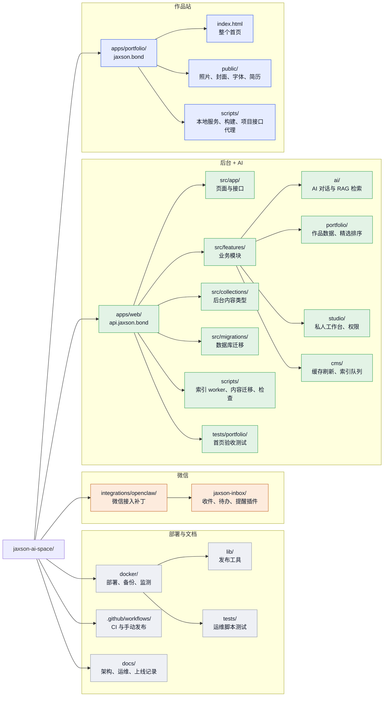

# 目录索引

每个文件夹和关键文件是做什么的。出问题时先看 [架构图与故障定位](./ARCHITECTURE.md) 找到大致位置，再在这里找具体文件。

`apps/web/src/directory-index.test.ts` 会检查下面列出的模块、内容类型、接口和脚本是否齐全：新增或删除这些文件时，记得同步改这份索引。

## 文件夹结构图

颜色和 [架构图](./ARCHITECTURE.md) 的分层对应：蓝色是作品站，绿色是后台和 AI，橙色是微信，灰色是部署运维。每个框写的是“文件夹/ 做什么”，具体文件见后面的表格。

图里略去了不常改的部分：`apps/web/public/`（后台用图片和简历）、`infra/postgres/init/`（数据库初始化）、根目录的 `scripts/`（早期备份脚本）、`.agents/skills/`（UI 审查技能），以及已停用的 `apps/web/src/features/openclaw/`。

## 根目录

| 路径 | 用途 |
| --- | --- |
| `apps/portfolio/` | 作品站 jaxson.bond：一个静态首页加本地服务脚本 |
| `apps/web/` | 后台和 AI（api.jaxson.bond）：Next.js 16 + Payload CMS 3 |
| `docker/` | 生产部署、备份、恢复、监测 |
| `integrations/openclaw/` | 个人微信接入（OpenClaw 插件） |
| `infra/postgres/init/` | 本地 Postgres 初始化（启用 pgvector） |
| `scripts/` | 早期的 PostgreSQL 加密备份与恢复脚本（`backup-db.sh`、`restore-db.sh`），生产已改用 `docker/` 里的备份 |
| `docs/` | 架构、运维手册、上线记录、部署交接 |
| `.github/workflows/deploy.yml` | CI 测试；在 main 上手动触发生产发布 |
| `.github/workflows/verify-production.yml` | 手动只读复核 PR #17 的运行版本、镜像、配置和发布备份，不部署或重启 |
| `.github/workflows/owner-backup.yml` | 换机恢复后的加密备份临时中转；只接受公钥，密文最多保留一天，本机验收后删除 |
| `.agents/skills/` | UI 设计审查技能（ui-ux-pro-max、frontend-design） |
| `package.json`、`pnpm-workspace.yaml` | pnpm 工作区：`pnpm dev`、`pnpm test`、`pnpm build` |
| `compose.dev.yaml`、`ecosystem.config.cjs`、`deploy.sh` | 早期的本地开发与部署方式，生产已改用 `docker/` |

## apps/portfolio（作品站）

| 路径 | 用途 |
| --- | --- |
| `apps/portfolio/index.html` | 整个首页：样式、结构和脚本都在这一个文件里。首屏三栏（对话框直接向 AI 提问并流式显示回答）、作品（精选大卡 + 更多项目列表）、履历、联系 |
| `apps/portfolio/public/` | 照片、项目封面、字体、简历 PDF；`optimized/` 是压缩后的 webp |
| `apps/portfolio/public/demos/` | 本站全站演示与待办备忘操作演示 MP4（H.264、16:10、静音）及 JPEG 封面；首页为这两个已公开项目提供内置视频，CMS 上传视频优先 |
| `apps/portfolio/scripts/serve.mjs` | 本地和生产的静态服务，带缓存头 |
| `apps/portfolio/scripts/showcase.mjs` | 只代理 `/api/showcase-projects` 到 CMS，不转发 cookie 或参数 |
| `apps/portfolio/scripts/config.mjs` | 读取 `PORTFOLIO_API_ORIGIN`，生成浏览器用的 `config.js` |
| `apps/portfolio/scripts/build.mjs` | 构建到 `dist/` |
| `apps/portfolio/scripts/optimize-images.py` | 把 `public/` 里的 PNG 压成带哈希的 webp，并更新 `optimized/images.json` |
| `apps/web/tests/portfolio/page.spec.ts` | 首页验收测试（Playwright，配置在 `apps/web/playwright.portfolio.config.ts`） |
| `apps/web/tests/web/pages.spec.ts` | `/ai`、`/resume`、项目页、404、媒体权限及请求体的浏览器测试；CI 覆盖 SQLite、PostgreSQL 生产容器及 WebKit 布局子集，WEB_TEST_BROWSER=webkit 选择引擎；跨域接续需配对首页（配置在 `apps/web/playwright.web.config.ts`） |

## apps/web/src/app（页面与接口）

| 路径 | 用途 |
| --- | --- |
| `apps/web/src/app/(frontend)/site.css` | `/ai`、`/resume`、项目页和 404 共用的冷白钴蓝样式（与首页一致）；私人工作台仍用旧的 `styles.css` |
| `apps/web/src/components/public-site/` | 这些页面共用的页头、页脚和指回作品集的链接（`links.ts`） |
| `apps/web/src/app/(frontend)/ai/` | AI 对话页 `/ai`（样式在 `ai.css`），支持 `?q=` 预填、停止与草稿、复制反馈、灰色内嵌编辑、同轮重新生成和项目来源新标签页跳转 |
| `apps/web/src/app/(frontend)/resume/` | 简历下载页 `/resume` |
| `apps/web/src/app/(frontend)/projects/[slug]/` | 项目详情页 |
| `apps/web/src/app/(frontend)/studio/` | 私人工作台（复盘、记忆、成长热力图），受访问控制 |
| `apps/web/src/app/(payload)/` | Payload 后台 `/admin` 和 REST / GraphQL 接口 |
| `apps/web/src/app/api/chat/` | AI 对话接口：限流、检索、流式回答 |
| `apps/web/src/app/api/showcase-projects/` | 首页用的公开项目列表，按精选和排序整理 |
| `apps/web/src/app/api/studio/` | 私人接口：`inbox/`（微信收件，口令 + 白名单）、`memory/`（记忆审核） |
| `apps/web/src/middleware.ts` | 私人页面和私人接口的访问控制 |

## apps/web/src/features（业务模块）

| 路径 | 用途 |
| --- | --- |
| `apps/web/src/features/ai/` | AI 对话：`chat-history.ts`（完整上下文及来源类型）、`chat-stream.ts`（前端读流及结构化来源）、`chat-capacity.ts`（每进程并发生成预算及读流释放）、`request-body.ts`（JSON 实际字节限制）、`conversation-handoff.ts`（跨窗口会话接续的数据校验）、`jd-intent.ts`（显式岗位匹配及 JD 判断）、`client-ip.ts`（真实访客 IP）、`initial-question.ts`（`?q=` 预填）、`suggestions.ts`（推荐问题）、`sse.ts` |
| `apps/web/src/features/ai/rag/` | 检索增强生成：`knowledge-loader.ts`（加载 CMS 资料和向量分数）、`retriever.ts`（有界用户追问上下文、关键词 + 向量混合检索）、`embedder.ts`（分词与本地向量）、`prompt-builder.ts`、`llm-stream.ts`（调用模型、失败兜底）、`db-pool.ts` |
| `apps/web/src/features/cms/` | `revalidate-hook.ts`（内容变更后刷新缓存、写入索引队列）、`email-config.ts`（后台邮件） |
| `apps/web/src/features/portfolio/` | 作品数据：`data.ts`（从 CMS 读取，保留公开参与说明给详情页和 AI）、`project-order.ts`（精选和排序规则，三处共用）、`cors.ts`（只允许作品集域名在浏览器里读取的公开接口）、`content.ts`（静态备用内容）、`urls.ts`、`cinematic-projects.json`（项目封面对照） |
| `apps/web/src/features/studio/` | 私人工作台：`private-access.ts`（权限）、`inbox-parser.ts`、`memory-extractor.ts`、`inbox-identities.ts`、`transaction.ts`、`analytics.ts`（热力图） |
| `apps/web/src/features/worker/` | `sync-worker.ts`（本地确定性向量）；worker 的测试 |
| `apps/web/src/features/openclaw/` | 已停用的旧微信 Hook，保留作对照；现用 `integrations/openclaw/` |

## apps/web/src/collections（后台内容类型）

| 路径 | 用途 |
| --- | --- |
| `apps/web/src/collections/Projects.ts` | 作品：公开 / 私有、首页精选、排序、封面、难题 / 做法 / 结果 |
| `apps/web/src/collections/Experiences.ts` | 实习、教育、校园经历 |
| `apps/web/src/collections/Credentials.ts` | 荣誉与技能 |
| `apps/web/src/collections/AIKnowledge.ts` | 给 AI 用的补充知识；默认不公开，由记忆生成的草稿也在这里 |
| `apps/web/src/collections/Reflections.ts` | 私人复盘（微信 fp 收件） |
| `apps/web/src/collections/Memories.ts` | 从复盘提炼的候选记忆和正式记忆，私有 |
| `apps/web/src/collections/Media.ts` | 上传的图片 |
| `apps/web/src/collections/Users.ts` | 后台账号 |
| `apps/web/src/migrations/` | 生产数据库迁移；新增迁移需按部署交接单独执行 |
| `apps/web/src/payload.config.ts` | Payload 配置：本地 SQLite、生产 PostgreSQL |
| `apps/web/src/payload-types.ts` | 自动生成的类型，改字段后用 `pnpm --filter @jaxson/web payload generate:types` 重新生成 |

## apps/web/scripts（运维脚本）

| 路径 | 用途 |
| --- | --- |
| `apps/web/scripts/run-index-worker.mjs` | 索引 worker：处理发布队列、生成向量；`--health` 查看队列状态 |
| `apps/web/scripts/reindex-knowledge.mjs` | 把所有公开内容重新加入索引队列 |
| `apps/web/scripts/cms-content.mjs` | CMS 内容导出 / 导入（本地 ↔ 生产） |
| `apps/web/scripts/check-deepseek.mjs` | 检查模型密钥和连接 |
| `apps/web/scripts/check-smtp.mjs` | 检查后台发信配置 |
| `apps/web/scripts/check-public-health.mjs` | 发布时检查 AI 页面和完整聊天流，带超时与响应预算，不记录问答正文 |
| `apps/web/scripts/seed-public-test.mts` | 只为明确命名的隔离 SQLite 测试库准备公开/私有项目和媒体样本，拒绝生产及本人开发库 |
| `apps/web/scripts/rehearse-database.mts` | 仅对空的本机 jaxson_rehearsal_* PostgreSQL 执行真实迁移升/降/重升，验证合成数据及私人表权限；也支持恢复后 verify |
| `apps/web/scripts/lib/index-embedding.mjs` | 向量生成：本地哈希或语义接口，1536 维 |
| `apps/web/scripts/lib/index-health.mjs` | 记录索引失败、生成健康报告 |
| `apps/web/scripts/lib/index-task-state.mjs` | 跳过同一记录的过期索引任务 |
| `apps/web/scripts/lib/cms-transfer.mjs` | `cms-content.mjs` 的导入导出逻辑 |
| `apps/web/scripts/lib/smtp-check.mjs` | 发信检查逻辑 |
| `apps/web/scripts/lib/smtp-config.mjs` | 发信配置解析 |

## docker（部署、备份、监测）

| 路径 | 用途 |
| --- | --- |
| `docker/Dockerfile.web`、`docker/Dockerfile.portfolio` | 两个应用镜像 |
| `docker/compose.vps-existing.yaml` | 当前 VPS 的服务：caddy、web、worker、portfolio（Postgres 是已有容器） |
| `docker/compose.rehearsal.yaml` | 仅本地合成数据的 PostgreSQL、生产镜像及 worker 演练；独立 Compose 项目和 loopback 端口，不读取生产配置 |
| `docker/migrations/003-security-update.sql` | 第 6 条迁移的受限运维 SQL；校验目标数据库及完整旧迁移历史，事务执行、记录版本；需先备份并另行确认生产执行 |
| `docker/compose.prod.yaml` | 完整的独立部署模板（含 Postgres、cloudflared） |
| `docker/Caddyfile` | 两个域名的反向代理、可信代理和缓存头；服务器上的副本需手动同步 |
| `docker/deploy-vps-existing.sh` | 发布：校验、迁移历史检查、备份、切换、健康检查、回滚 |
| `docker/verify-vps-existing.py` | PR #17 发布后的只读复核快照；经固定 SSH 主机信任通道执行，不读取凭据或数据库正文 |
| `docker/lib/` | 发布工具：`release.sh`、`release_candidate.py`、`release_images.py`、`release_snapshot.py`、`release_retention.py`（发布成功后只保留当前和回滚版本的镜像与发布包）、`compose.sh`、`private_backup.py` |
| `docker/backup-vps-existing.sh`、`docker/restore-vps-existing.sh` | 当前 VPS 的完整备份与恢复 |
| `docker/backup.sh`、`docker/restore.sh` | 独立部署模板的备份与恢复 |
| `docker/export-private-backup.sh`、`docker/create-private-export.py`、`docker/install-private-export.py`、`docker/serve-private-backup.py` | 加密私有备份的导出与受限下载 |
| `docker/enable-backup-key.py` | 在 VPS 上为备份下载配置受限的 SSH 公钥 |
| `docker/windows-pull-backup.py` | 站长电脑拉取并校验加密备份 |
| `docker/windows-pull-actions-backup.py` | SSH 直连不可用时，通过 GitHub 中转密文并在本机解密校验；验收后删除中转 |
| `docker/prepare-owner-backup.py` | 明确授权换机后的公钥恢复；保留旧公钥和受限 SSH 授权，生成新的加密导出 |
| `docker/windows-monitor.py` | 站长电脑上的在线监测（电脑关机时无法监测） |
| `docker/lib/windows_network.py` | 运维 SSH/SMTP 按配置绑定 Windows 网卡，保留 SSH 主机指纹和 SMTP TLS 主机名校验，不修改全局代理或路由 |
| `docker/notify-vps-failure.sh`、`docker/notify-vps-failure.mjs` | 备份失败通知 |
| `docker/jaxson-vps-backup.*`、`docker/jaxson-backup.*` | systemd 定时备份 |
| `docker/init-schemas.sh`、`docker/migrations/` | 数据库 schema（owner / public_read）与向量索引初始化 |
| `docker/bootstrap-admin.mjs`、`docker/check-env.mjs`、`docker/smoke.mjs` | 首个管理员、环境变量检查、冒烟测试 |
| `docker/tests/` | 发布与备份工具的测试（Python、Node）；`test_public_delivery.py` 检查两份简历的事实与一致性、代理缓存策略 |
| `docker/requirements.test.txt` | CI 和本地 Python 测试依赖（含 PDF 文本检查）；电脑备份仍单独使用 `docker/requirements.pc-ops.txt` |

## integrations/openclaw（微信）

| 路径 | 用途 |
| --- | --- |
| `integrations/openclaw/jaxson-inbox/` | OpenClaw 插件：`fp` 复盘发到 `/api/studio/inbox`，`td` 待办发到待办应用，`reminders.mjs` 负责提醒，`receipts.mjs` 负责回执 |
| `integrations/openclaw/weixin-admission.mjs`、`weixin-context.mjs`、`weixin-inbox-path.mjs` | 对腾讯微信插件的补丁：只接受本人、补齐发送者 ID、私人收件直通 |
| `integrations/openclaw/prepare-vps.sh`、`compose.yaml`、`versions.json` | 在 VPS 上安装和锁定版本 |
| `integrations/openclaw/README.md` | 接入说明与限制 |

## docs（文档）

| 路径 | 用途 |
| --- | --- |
| `docs/ARCHITECTURE.md` | 架构图与故障定位表 |
| `docs/部署交接-2026-10-22.md` | 当前分支的发布步骤 |
| `docs/生产运维与数据迁移.md` | 日常运维：内容迁移、重建索引、备份恢复、密码恢复 |
| `docs/独立审查报告-2026-10-21.md` | 最近一次全面审查的问题清单 |
| `docs/CURRENT.md` | 当前进度 |
| `docs/收尾与换机运维恢复-2026-10-30.md` | 发布后独立服务器复核、新电脑加密备份/监测恢复、代理网络问题、实测任务与人工验收边界 |
| `docs/UI收尾验收-2026-10-29.md` | 项目弹窗最终方案、170 项完整回归及 WebKit 等检查、预览与待发布边界 |
| `docs/UI发布执行-2026-10-29.md` | PR #15 的实际合并、完整 CI/部署、备份回退、线上独立验收与内容阶段交接 |
| `docs/知识补充-2026-10-29.md` | 两条获准知识的 CMS 录入、旧文案同步、问答及索引验收；短追问问题与本地修复状态 |
| `docs/追问与技术问法发布-2026-10-29.md` | PR #16 的短追问、自然技能问法与指定项目检索修复，以及 CI、发布和视频验收记录 |
| `docs/项目封面与演示视频-2026-10-29.md` | 本站全站视频、待办实录、新封面的 PR #17 发布与公网播放/Range 验收、待补充 SSH 复核 |
| `docs/发布执行-2026-10-29.md` | 已完成的生产发布、迁移及配置、备份回退位置、公网验收与剩余事项 |
| `docs/历史交接状态-2026-10-28.md` | 发布前各轮进展的历史快照；其中未部署描述不代表当前状态 |
| `docs/上线候选验收-2026-10-28.md` | 本地生产镜像与 PostgreSQL 的验收结果、复现方法、迁移/配置/发布顺序、回退与发布窗口验收 |
| `docs/发布前环境复核-2026-10-28.md` | 草稿 PR/CI、生产版本与配置存在性、实际备份隔离恢复及 SMTP 认证结果，不含凭据与私人正文 |
| `docs/全项目审计-2026-10-28.md` | 排除知识库内容建设的全项目审计：依赖、权限、接口、页面、发布、视频、微信测试和运维验收 |
| `docs/数字分身与私人记忆-2026-10-28.md` | 两条记忆通路、能力核对、访谈方式、架构讲解与待办验收；不保存私人访谈正文 |
| `docs/核对与完善-2026-10-27.md` | 本轮线上只读核对、本地修复、验证证据和生产待办 |
| `docs/生产配置修复方案-2026-10-27.md` | 经 SSH 核实的 Caddy 配置问题、最小改动、双副本同步、验收与回退方案 |
| `docs/jaxson-ai-space-content-draft.json` | Jaxson AI Space 的本地项目文案稿，按 slug 匹配；供核对与后续 CMS 更新使用，尚未写入生产 |
| `docs/历史交接状态-2026-10-21.md` | 旧 CURRENT 原文归档，不能用来判断当前分支或生产状态 |
| 其他带日期的文档 | 每次上线或修复的记录，作为历史证据保留 |
